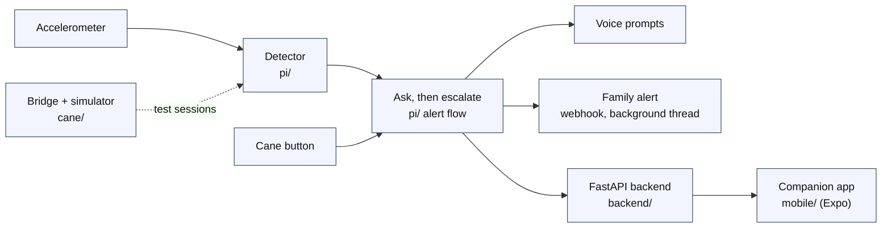

# Handy Cane

An assistive smart cane: sensors on the cane detect when it goes down or is dropped, the cane asks the user out loud if they are okay, and if nobody answers it raises an alert for caregivers. A companion app serves the cane user, their caregivers, and clinicians.

## What it does

- **Cane-down detection** from the cane's accelerometer (LIS3DH): cane down after an impact, cane down with no impact, and pickup when the cane is lifted again.
- **Stumble detection**: a sharp jolt where the cane stays upright - logged with peak g-force, no alarm.
- **Parked detection**: when the cane is hung up or leaning still, bumps are ignored.
- **Ask, then escalate**: on a possible fall the cane speaks "Are you okay? Press the button if you are fine." A short button press cancels. No answer escalates to a caregiver alert. Timing is impact-based: after an impact the cane asks at 10s and alerts at 30s; with no impact it asks at 30s and alerts at 60s.
- **SOS button**: hold the cane button for 2 seconds to trigger an SOS alert.
- **Voice prompts**: pre-generated ElevenLabs speech on the cane, with an espeak fallback and a paired phone as an optional speaker.
- **Companion app**: the patient sees cane-active time against their own baseline, alerts, and trend reports. Caregivers and clinicians see a patient list with priority badges and per-patient overview, trends, alerts, and reports. Caregiver access is consent-gated by the patient.
- **Alert severity for triage**: high / medium / low ordering so a caregiver knows what to look at first.

Severity is a prioritization heuristic computed from the event (what happened, whether anyone answered, impact strength). It is not a medical or clinical assessment.

## Repository layout

- `pi/` - Raspberry Pi cane runtime: detector, alert flow, voice prompts, phone web page, REST API and live event feed
- `cane/` - CaneLink bridge and cane sensing libraries, with a simulator (`run_sim.py`)
- `backend/` - FastAPI backend: events, alerts, reports, severity ordering
- `mobile/` - Expo / React Native companion app (patient, caregiver, clinician)
- `firmware/`, `hardware/`, `interface/`, `app/` - original planning notes and scaffolds
- `tools/` - session recording and evaluation utilities
- `tests/` - cane regression tests and fixtures
- `docs/` - setup, deployment, and data-collection notes

## Architecture

The constraint this project is built around: **the cane asks first and escalates only when nobody answers, and nothing in the system is a medical claim.**

1. pi/detector.py is pure logic over the accelerometer stream: it separates gravity from dynamic motion, tracks tilt against the upright vector, and emits events: cane down with impact, cane down without impact, pickup, stumble (logged with peak g-force, no alarm) and parked (bumps ignored).
2. On a possible fall the cane speaks "Are you okay? Press the button if you are fine." After an impact it asks at 10 seconds and alerts at 30; with no impact, at 30 and 60. A short button press cancels; a 2-second hold is an SOS.
3. Family alerts go out through a webhook on a background thread, so the cane never pauses on the network (pi/alerts.py).
4. The FastAPI backend stores events, alerts and trend reports and orders alerts by a severity heuristic for triage; the README is explicit that severity is prioritization, not a clinical assessment.
5. The Expo companion app serves three roles: the cane user sees their own activity against their own baseline, caregivers (consent-gated by the patient) and clinicians see priority-ordered patient lists. Demo mode runs with no backend; the cane wire format is documented in mobile/PROTOCOL.md.
6. Detection is exercised against simulated and recorded sessions through the bridge and simulator in cane/ and the regression suite in tests/. Performance on real human falls has not been validated, and the README says so.

Design decisions and limits: [docs/ARCHITECTURE.md](docs/ARCHITECTURE.md).

## Status

Current build state. On the reviewed branch `review/integration-plus-dev-clean`: 122 backend tests, 152 mobile tests, and 16 regression tests pass, and the mobile app type-checks cleanly.

Fall and drop behavior has been exercised against simulated and recorded sensor sessions. Detection performance on real human falls has not been validated, and nothing in this project is a medical device or a clinical claim.
