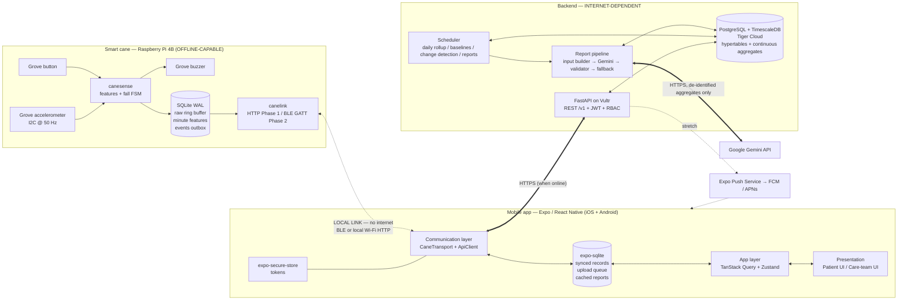
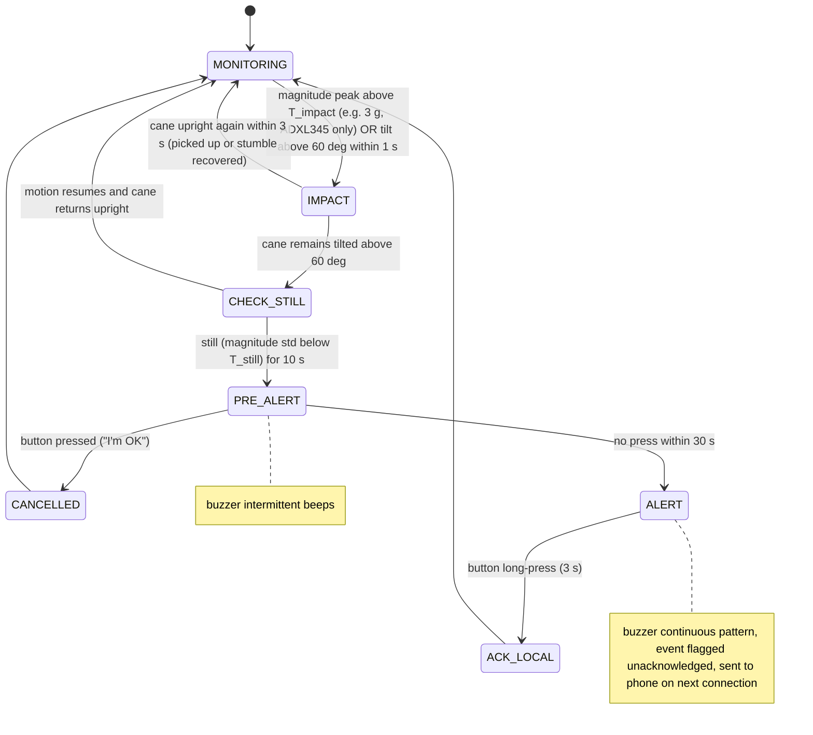
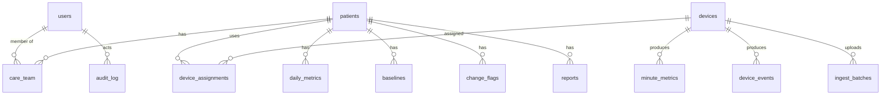
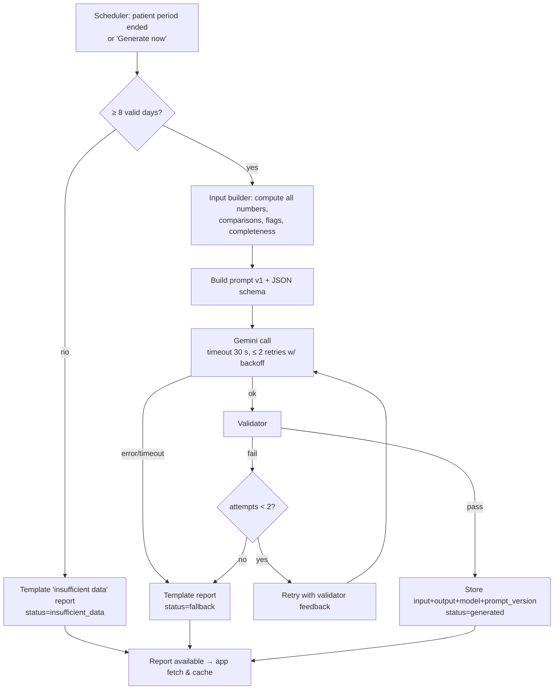

# master.md — Smart Cane Longitudinal Mobility Monitoring Platform

> **Single source of truth** for the software side of our BioHacks 2026 project.
> Written so a teammate or an AI coding assistant can rebuild the whole system from this file alone.
> Last updated: 2026-11-07 (during the event). Owner: software team.

---

## 0. How to read this document

### 0.1 Status labels

| Label | Meaning |
|---|---|
| **DECIDED** | The team stated this as a requirement. Do not change without a team decision. |
| **RECOMMENDED** | Our engineering recommendation. Default to it unless someone has a concrete reason not to. |
| **PROPOSED** | A reasonable design that still needs validation (e.g. thresholds that need tuning on real data). |
| **UNRESOLVED** | An open question. Section 22 lists all of them. |
| **FUTURE SCOPE** | Deliberately out of the hackathon MVP. |

### 0.2 Evidence labels (used where claims matter)

| Tag | Meaning |
|---|---|
| `[FACT]` | Verified against official docs or primary sources (see References). |
| `[RESEARCH]` | Supported by published research; may not transfer directly to our setup. |
| `[ENG]` | Engineering judgement / reasoning, not externally verified. |
| `[ASSUMPTION]` | Unverified; must be checked. |

### 0.3 Inputs this document was built from

- The team's task brief (the only attachment supplied). **No existing master.md, hardware spec sheet, or patient problem statement was provided**; the patient case is only revealed at the event [FACT: BioHacks site]. Where those would change decisions, this document says so.
- Official docs and research listed in Section 25.

---

## 1. Executive summary

We are building a **smart-cane mobility monitoring system** for the BioHacks 2026 *Wearable Devices and Quality of Life* track.

- A **Raspberry Pi 4B** with a Grove 3-axis accelerometer, buzzer and button is mounted on a single-point cane. It samples motion, **detects potential falls locally**, sounds the buzzer, lets the patient cancel a false alarm with the button, and logs everything to local storage. **It never needs the phone, the internet, the backend, or Gemini to do this.** (DECIDED)
- A **React Native (Expo) mobile app** for iOS/Android pairs with the cane over a local link, pulls the cane's logged data, caches it on the phone, shows activity and alerts, and uploads to the backend when online. (DECIDED: mobile-first)
- A **FastAPI backend** with **PostgreSQL + TimescaleDB (Tiger Data)** stores minute-level cane metrics, builds **per-patient baselines**, detects **sustained** changes using robust statistics (not deep learning), and every 14 days builds a **deterministic, numeric report input**.
- **Gemini** only turns that pre-computed, validated input into plain-language text inside a strict JSON schema. Every number in the report comes from the backend; Gemini's text is checked against it before anyone sees it. If Gemini fails, a template report is produced instead.

**The biggest changes from the original concept** (details in Section 3):

1. The cane measures **cane motion, not patient gait**. We report "cane-use" indicators and say so explicitly.
2. **Missing data is a first-class concept.** The cane sends a summary record for *every* minute it is powered (even idle ones), so "no record" means "no data", never "no activity".
3. **The Pi 4 has no real-time clock**, so offline timestamps can be wrong. We add a time-sync handshake and a time-quality flag on every record.
4. **The fall detector cannot tell "patient fell" from "cane was dropped"** using one accelerometer. We call events "potential fall / cane drop" and use the button as an "I'm OK" cancel.
5. **The phone↔cane link is transport-agnostic.** We build an HTTP-over-local-Wi-Fi transport first (fast to build and debug), and BLE second (the right long-term choice).
6. Patients **dismiss** events with a reason instead of **deleting** them; deleting would hide safety data from clinicians.
7. The Gemini **free tier lets Google use the content to improve its products**, so nothing identifying is ever sent.

---

## 2. Problem statement and context

### 2.1 Hackathon context [FACT]

- **Event:** BioHacks 2026, McMaster University, Hamilton ON, **November 7–8, 2026**, an official MLH Member Event.
- **Format:** All teams design for the same **neurological patient case, revealed at the opening ceremony**; teams pitch at the closing ceremony. The site describes the pitch as an evidence-backed proposal; no formal judging criteria are published.
- **Tracks:** Detection & Diagnostics; Therapeutics & Delivery; **Wearable Devices & Quality of Life** (helping the patient continue the activities that matter to them as their abilities change). **We target this track.** (DECIDED)
- **Listed sponsors include:** Google Gemini, ElevenLabs, GitHub, Solana, Vultr, Tiger Data, GoDaddy Registry, DigiKey, Bambu Lab, ALS Canada, among others.

### 2.2 The problem we address [ENG]

People with progressive neurological conditions who use a cane face two linked problems:

1. **Acute safety:** falls happen at home, alone. Help is delayed if nobody knows.
2. **Slow decline goes unseen:** clinicians see the patient briefly every few months. Gradual changes in how much and how steadily someone moves between visits are invisible, and changes in assistive-device needs are noticed late.

Our system addresses (1) with **on-cane, offline fall alerting**, and (2) with **objective, continuous, personalized cane-use trends**, summarized every two weeks in language patients and clinicians can read.

### 2.3 Patient case adaptation — UNRESOLVED

The case is revealed at the event. When known, update this section with: diagnosis, mobility stage, home situation, caregiver presence, and which indicators matter most. Examples of how the case changes priorities [ENG]:

| If the case is… | Emphasize | Caution |
|---|---|---|
| Progressive weakness (e.g., ALS) | Week-over-week decline in active minutes and bout length; device-transition planning (cane → walker) | Decline is expected; frame reports around planning, not alarm |
| Parkinsonism | Strike-interval regularity, very short bouts, near-fall impacts | We cannot detect freezing of gait reliably with a cane accelerometer |
| MS (relapsing) | Day-to-day variability, fatigue patterns by time of day | Sustained-change detection must not over-react to relapses that resolve |
| Post-stroke | Recovery trend (increasing activity) | Report must handle improvement, not just decline |

---

## 3. Critical evaluation of the original concept

### 3.1 Incorrect or risky assumptions

| # | Original assumption | Problem | Resolution |
|---|---|---|---|
| A1 | Cane acceleration reflects patient gait, walking speed, balance | The sensor is on the cane, not the body. Cane motion depends on how the cane is used (gait pattern, which hand, whether it's carried). Integrating acceleration for speed/distance drifts quickly [ENG]. Published instrumented canes that estimate gait quality generally use richer sensors (force sensors in addition to inertial) and validate against clinical scores or body-worn IMUs [RESEARCH] | Report **cane-use indicators**. Never claim speed, distance, balance, or disease progression. See Section 9. |
| A2 | No data = patient inactive | Cane may be off, out of range, charging, or patient walked without it | Per-minute **coverage records** + daily validity rules (Section 9.4) |
| A3 | Firmware can timestamp records offline | Raspberry Pi 4 has **no RTC**; without network time after a reboot the clock is wrong [FACT] | Time-sync handshake from the phone + `time_quality` flag (Section 7.5) |
| A4 | Cane fall = patient fall | A dropped cane looks very similar to a cane falling with the patient | Label as "potential fall / cane drop"; "I'm OK" button cancel; never show as a confirmed fall |
| A5 | Public fall datasets can train our model | Public fall datasets mostly use body-worn sensors; the domain differs from a cane mount [RESEARCH/ENG] | Threshold state machine first; collect our own cane data; use public data only for sanity checks (Section 10) |
| A6 | ElevenLabs unusable because we lack listening devices | **The phone has a speaker.** The cane can't play audio (buzzer only), but the app can | Optional extension: read reports aloud in-app (Section 18) — low priority |
| A7 | Patients can delete incidents | Hard-deleting fall events removes safety evidence from clinicians and caregivers | **Dismiss with reason** (soft state, audited). Clinicians see "dismissed by patient: false alarm" |
| A8 | Gemini should "analyze" data | LLMs can produce schema-valid but wrong content [FACT: Gemini docs] | Backend computes all findings; Gemini only phrases them; validator checks every number |
| A9 | Pi on a cane is fine | A Pi 4 + power bank is heavy and power-hungry for a cane | Acceptable for a prototype; production would use a microcontroller (FUTURE SCOPE). State this in the pitch |
| A10 | Accelerometer model is known | The MLH inventory lists only "Grove 3 Axis Digital Accelerometer" without range [FACT]. Seeed sells a **±16 g (ADXL345)** and a **±1.5 g (MMA7660)** version [FACT] | **Check immediately** (Section 6.2). A ±1.5 g sensor will saturate on impacts and seriously weakens fall detection |

### 3.2 Missing components the original brief did not cover

- Device clock synchronization and time-quality tracking.
- Per-minute "heartbeat/coverage" data so missing ≠ zero.
- Sensor mounting calibration (axis orientation relative to the cane shaft).
- Idempotent, resumable sync protocol with sequence numbers.
- Event lifecycle (detected → cancelled/escalated → acknowledged/dismissed).
- Report provenance (inputs, model, prompt version stored with each report).
- A deterministic fallback when Gemini is unavailable.
- Simulated-data labelling end-to-end (DB column → API → UI badge).
- Audit logging of who viewed/changed patient data.

### 3.3 Unnecessary complexity to cut

- **LSTM/1D-CNN for fall detection** in the MVP: no cane-specific training data exists yet. A tuned threshold state machine is the defensible baseline (published cane work found a finite-state machine close to an LSTM's accuracy [RESEARCH]).
- **ML for longitudinal analysis:** with one patient and weeks of data, robust statistics beat ML in reliability and explainability.
- **Streaming raw 50 Hz data to the phone/cloud:** unnecessary for longitudinal metrics; send minute summaries.
- **Firebase** for both auth and push: adds a vendor and setup time. Use backend-issued JWT; treat push as stretch.
- **Next.js / web dashboard:** not needed; mobile is primary (DECIDED). FUTURE SCOPE.
- **Solana:** no genuine fit. Skip.

---

## 4. Project objectives

| ID | Objective | Priority |
|---|---|---|
| O1 | On-cane potential-fall detection with local buzzer alert and button cancel, fully offline | P0 (hardware team; software defines the interface) |
| O2 | Reliable, duplicate-free sync of cane data → phone → backend with clear missing-data handling | P0 |
| O3 | Per-patient baseline and sustained-change detection on cane-use indicators | P0 |
| O4 | Biweekly Gemini-written report built only from backend-verified numbers | P0 |
| O5 | Accessible mobile app: patient view and clinician/caregiver view | P0 |
| O6 | Clearly labelled simulated 8-week history for the demo | P0 |
| O7 | Caregiver remote notification of potential falls | P2 (stretch) |
| O8 | Fall model trained on collected cane data | P2 / FUTURE SCOPE |

---

## 5. System boundaries and responsibilities

### 5.1 Responsibility split (DECIDED in brief, refined here)

| Layer | Owns | Must work without |
|---|---|---|
| **Cane (Pi 4 + sensors)** | Sampling, fall detection, buzzer, button, local log, per-minute features, time-quality tracking, serving data to the phone | Phone, internet, backend, Gemini |
| **Mobile app** | Pairing, pulling cane data, local cache, display, upload queue, event acknowledgement, viewing cached reports | Internet (for local functions), backend, Gemini |
| **Backend** | Auth, permissions, storage, validation, daily rollups, baselines, change detection, report pipeline, Gemini calls | Gemini (falls back to template) |
| **Gemini** | Wording of report narrative only | — |

### 5.2 Offline vs internet-dependent (DECIDED)

| Always works offline | Needs internet (may be delayed) |
|---|---|
| Sensor sampling, local processing, fall detection, buzzer, button | Backend sync, cloud storage |
| Local logging on the Pi | Remote caregiver/clinician access |
| Phone ↔ cane connection and data pull | Gemini reports |
| Viewing previously synced data and downloaded reports on the phone | Cloud analytics, baselines |
| | Remote push notifications |

**Safety invariant:** No failure in the phone, network, backend or Gemini may delay or block the cane's detection → buzzer path. Implementation rule: the sensing/alert process on the Pi is a **separate process** from any communication process, and communicates with it only through the local database (Section 6.4).

---

## 6. Hardware interface (what software needs to know)

The physical cane and firmware are out of this document's main scope, but the software depends on these facts.

### 6.1 Inventory (DECIDED: what we have)

Raspberry Pi 4B kit, Seeed Grove Base Hat, Grove 3-axis digital accelerometer, Grove buzzer, Grove button, Grove cables, male–female jumpers.

[FACT] The Raspberry Pi 4B has on-board Wi-Fi and Bluetooth 5.0 (BLE), and **no real-time clock**.

### 6.2 Accelerometer identification — do this first

The two Seeed variants use different I²C addresses [FACT: Seeed wiki]:

```bash
sudo apt install -y i2c-tools
i2cdetect -y 1
# 0x53 → ADXL345 (±16 g, up to 3.9 mg/LSB)  → good for fall detection
# 0x4c → MMA7660FC (±1.5 g, low resolution) → impacts will saturate
```

If it is the ±1.5 g part [ENG]: impact peaks clip at 1.5 g, so detection must rely on **orientation change + post-event stillness** rather than impact magnitude, and false-alarm rates will be worse. Record which part you have in Section 22 (U1).

### 6.3 Sensor configuration — PROPOSED

| Parameter | Value | Reason |
|---|---|---|
| Sample rate | 50 Hz | Human movement energy is mostly well under 20 Hz [ENG]; 50 Hz leaves headroom for impact peaks and keeps raw logs small |
| Range (ADXL345) | ±16 g, full resolution | Avoid clipping on impact |
| Mount | Rigidly on the shaft, below the handle, fixed orientation | Shaft-axis estimation depends on a fixed mount |
| Calibration | At setup: hold cane vertical and still for 3 s; store gravity vector as "upright reference" | Lets us compute tilt from vertical regardless of mount rotation |

### 6.4 Pi software processes — RECOMMENDED

```
canesense.service   (systemd, Restart=always, highest priority)
  ├─ reads accelerometer @ 50 Hz
  ├─ runs fall state machine → buzzer / button
  ├─ writes raw ring buffer + minute features + events to SQLite (WAL mode)
canelink.service    (systemd, Restart=always)
  ├─ reads SQLite outbox
  ├─ serves phone over HTTP (Phase 1) and BLE GATT (Phase 2)
  └─ accepts time-sync and acks from phone
```

If `canelink` crashes, `canesense` keeps running. SQLite in WAL mode allows one writer and concurrent readers [ENG].

---

## 7. Cane ↔ phone communication

### 7.1 Options compared

| Option | Internet needed? | Phone keeps internet? | App build complexity | Pi complexity | Battery | Verdict |
|---|---|---|---|---|---|---|
| **BLE GATT (Pi = peripheral)** | No | Yes | Needs Expo **development build** (not Expo Go) + config plugin [FACT] | Moderate: BlueZ GATT server via Python (`bluez-peripheral` / `bless`) | Best | **Target transport** |
| **Pi-hosted Wi-Fi AP** | No | Often **no** — phone joins the Pi's network and may lose its internet route | Low (plain `fetch`) | Moderate (hostapd/dnsmasq) | Poor (Wi-Fi radio) | Reject: breaks phone→backend upload while connected |
| **Shared LAN / phone hotspot, HTTP** | No (a hotspot needs no cellular data to exist) | Yes | **Lowest** — works even in Expo Go | Lowest (FastAPI/Flask on Pi) | Poor | **Phase-1 transport** for build speed and demo fallback |
| Bluetooth Classic serial | No | Yes | Not supported by `react-native-ble-plx` [FACT] | Moderate | Medium | Reject |

### 7.2 Decision — RECOMMENDED

1. Define **one sync protocol** (Section 7.4) independent of transport.
2. **Phase 1:** implement it over **HTTP on a local network** (venue Wi-Fi, or the phone's hotspot with the Pi joined to it). Pi address entered in a developer settings screen, with `canepi.local` mDNS as a convenience. This unblocks the app and backend within hours.
3. **Phase 2:** implement the same protocol over **BLE GATT** using `react-native-ble-plx` in an Expo development build. BLE is what we present as the architecture.
4. If BLE isn't stable by the demo, demo on HTTP and **state that honestly**.

### 7.3 Raw vs aggregated data

| Approach | Volume | Notes |
|---|---|---|
| Continuous raw 50 Hz × 3 axes × int16 | ~300 B/s ≈ **26 MB/day** [ENG arithmetic] | Too much for BLE notifications all day; drains phone; not needed for trends |
| **Per-minute feature records** (≈ 200 B each, 1,440/day) | ≈ **0.3 MB/day** | **RECOMMENDED** primary payload |
| Raw snippet around each potential fall (±10 s) | ~6 KB/event | RECOMMENDED: needed for labelling and future model training |
| Live preview (1–2 Hz magnitude) | Tiny | Only while the "Live" screen is open (demo value) |

Raw data stays on the Pi in a rolling 7-day ring buffer (PROPOSED) for debugging and dataset collection.

### 7.4 Sync protocol (transport-agnostic) — RECOMMENDED

Every record created on the Pi gets:

- `device_id` (stable, e.g., `cane-7f3a`)
- `seq` — strictly increasing 64-bit integer **per device**, persisted across reboots (never reused)
- `boot_id` — random UUID generated at each boot
- `mono_ms` — monotonic milliseconds since boot
- `ts` — wall-clock UTC as the Pi believes it
- `time_quality` — `synced` | `unsynced` | `corrected`

**Pull model** (phone always initiates):

```mermaid
sequenceDiagram
    participant P as Phone app
    participant C as Cane (canelink)
    participant DB as Pi SQLite
    P->>C: HELLO {app_version}
    C-->>P: INFO {device_id, fw_version, last_seq, unsynced_count, sensor_model}
    P->>C: TIME_SYNC {phone_utc_ms}
    C->>DB: store offset for current boot_id; fix unsynced rows of this boot
    loop until caught up
        P->>C: PULL {after_seq: cursor, limit: 500}
        C->>DB: SELECT * WHERE seq > cursor ORDER BY seq LIMIT 500
        C-->>P: PAGE {records[], next_cursor, more: bool}
        P->>P: write page to local SQLite in ONE transaction
        P->>C: ACK {up_to_seq}
        C->>DB: mark synced_to_phone ≤ up_to_seq
    end
```

Guarantees:

- **No duplicates:** the phone and backend both enforce uniqueness on `(device_id, seq)`; re-sent pages are ignored (`ON CONFLICT DO NOTHING`).
- **Resumable:** the phone stores its cursor; an interrupted transfer resumes from the last committed page.
- **No loss:** the Pi only marks rows synced after the phone acknowledges a durable local write. The Pi never deletes unsynced rows unless storage is critically low (then oldest raw data goes first, never events or minute features).
- **Multiple phones:** each phone keeps its own cursor; backend dedup makes double uploads harmless.

### 7.5 Time handling — RECOMMENDED

- On every connection the phone sends its UTC time. The Pi computes `offset = phone_utc − (boot_wall_estimate + mono_ms)` for the current `boot_id` and rewrites `ts` for this boot's rows; they become `corrected`.
- Rows from an **earlier** boot that never received a time sync stay `unsynced`. The backend stores them but **excludes them from daily metrics** unless they can be anchored (e.g., the Pi got NTP during that boot). They still count toward event history with a "time uncertain" badge.
- All storage is **UTC** (`timestamptz`). Daily aggregation uses the **patient's IANA timezone** (e.g., `America/Toronto`) so "a day" matches the patient's day.
- FUTURE SCOPE: add an RTC module to remove this problem.

### 7.6 BLE GATT design — PROPOSED (Phase 2)

Custom 128-bit UUIDs (generate once and record here).

| Characteristic | Props | Payload |
|---|---|---|
| `info` | read | JSON: device_id, fw_version, sensor_model, last_seq, unsynced_count |
| `time_sync` | write | int64 phone UTC ms |
| `control` | write | JSON command: `{"op":"pull","after_seq":N,"limit":K}` / `{"op":"ack","up_to_seq":N}` / `{"op":"live","on":true}` |
| `data` | notify | Chunked frames: `[msg_id u16][chunk_idx u16][chunk_count u16][payload…]`; payload is UTF-8 JSON (or CBOR later) |
| `alert` | notify | Small JSON for a new potential-fall event, sent immediately when connected |

Notes [ENG/FACT]:
- Negotiate a larger MTU from the phone (`react-native-ble-plx` supports MTU negotiation [FACT]); still chunk, because MTU varies by phone.
- Pi side: `bluez-peripheral` (Python, BlueZ D-Bus) or `bless` [FACT: both exist]. Pick one; `bluez-peripheral` is Linux-specific and simpler on the Pi.
- Pairing/bonding: `react-native-ble-plx` does **not** support bonding [FACT]. For the MVP use an unbonded connection plus an app-level device pairing code (Section 16.4).

---

## 8. Software architecture

### 8.1 System diagram



### 8.2 Data movement, end to end

1. `canesense` samples at 50 Hz, computes features every minute, writes one `minute` record per powered minute (even idle), and writes `event` records when the fall FSM or button fires.
2. When the phone is nearby, `canelink` serves records by `seq`. The phone stores them locally and acks.
3. The phone's upload worker sends batches to `POST /v1/ingest/batches` whenever online. The backend dedups on `(device_id, seq)`.
4. The backend's continuous aggregate updates daily rollups; a nightly job computes daily validity, baselines and change flags.
5. Every 14 days (or on demand in the demo), the report pipeline builds the input, calls Gemini, validates, stores, and marks the report available. The app fetches and caches it for offline reading.

---

## 9. What the cane accelerometer can and cannot tell us

This is the scientific core of the project. Use this table in the pitch.

### 9.1 Measurement hierarchy

| Level | Examples | Validity | Limitation |
|---|---|---|---|
| **Directly measured** | 3-axis acceleration of the cane at the mount point (incl. gravity) | High for what it is | Says nothing directly about the body |
| **Derived features** (deterministic signal processing) | Acceleration magnitude, dynamic acceleration, tilt from vertical, impact peaks, cane-tip strike events and intervals, motion vs still | High, if mount is fixed and calibrated | Depends on mount, cane type, which hand |
| **Cane-use indicators** (our reported metrics) | Cane-active minutes/day, cane strikes/day, walking-bout count and length, strike-rhythm regularity, cane-upright time, potential-fall/drop events | Moderate; plausible proxies for **how the cane is used** | Not validated against clinical outcomes for this device; confounded by not using the cane |
| **Clinically validated measures** | Gait speed, Timed Up and Go, Berg Balance, Dynamic Gait Index, fall risk | **We do not produce these.** Research canes with more sensors have been compared to such scores [RESEARCH] | Would require a validation study (FUTURE SCOPE) |

### 9.2 Things we must never claim

Walking speed, distance, step count of the patient, balance, gait quality, fall risk scores, disease progression, diagnosis, or that a patient "fell" (only "potential fall or cane drop").

### 9.3 Feature definitions — PROPOSED (computed on the Pi per minute)

Let `a = (ax, ay, az)` in g, `|a|` the magnitude, `u` the calibrated upright gravity unit vector.

| Feature | Definition | Purpose |
|---|---|---|
| `n_samples` | Samples captured this minute (expected 3000) | Coverage/quality |
| `mag_mean`, `mag_std`, `mag_max` | Stats of `|a|` | Intensity, impacts |
| `dyn_mean` | mean of `max(|a| − 1, 0)` (ENMO-style) | Movement intensity, gravity-removed |
| `active_s` | Seconds where 1-s rolling std of `|a|` > `T_active` | Cane in motion |
| `strike_count` | Peaks in high-pass `|a|` above `T_strike`, ≥ 0.4 s apart | Cane-tip ground contacts |
| `strike_iv_mean`, `strike_iv_cv` | Mean and coefficient of variation of intervals between consecutive strikes (only if ≥ 5 strikes) | Rhythm/regularity of cane use |
| `upright_s` | Seconds with tilt angle from `u` < 30° | Cane held upright vs lying/leaning |
| `flat_s` | Seconds with tilt > 70° and still | Cane lying down (dropped/stored) |
| `max_impact_g` | Max `|a|` | Impact screening |

Thresholds `T_active`, `T_strike` are PROPOSED placeholders to tune on walking data collected during the event (Section 20.2).

### 9.4 Missing data vs zero activity — RECOMMENDED rules

- A **minute record exists** ⇔ the cane was powered and sampling. Idle minutes produce records with `active_s = 0`.
- `coverage_minutes(day)` = minute records with `n_samples ≥ 0.9 × 3000` and `time_quality ≠ unsynced`.
- A day is **valid** if coverage ≥ **10 hours between 07:00–22:00 local** (PROPOSED; tune to the patient's routine).
- Invalid days are **excluded** from baselines and trends and shown as grey "no data" in charts — never as zero.
- A period (14 days) is **reportable** if ≥ 8 valid days (PROPOSED). Otherwise the report says data was insufficient and gives only completeness information.
- "Cane powered but never moved all day" is shown as "cane not used", which may mean the patient walked without it. The UI and report say exactly that.

### 9.5 Daily metrics (backend)

| Metric | Computation | Shown to |
|---|---|---|
| `valid` | Rule in 9.4 | All |
| `coverage_h` | coverage_minutes / 60 | All |
| `active_min` | Σ active_s / 60 | All |
| `strikes` | Σ strike_count | All ("cane steps") |
| `bouts`, `bout_median_s`, `bout_longest_s` | Bout = run of consecutive minutes with ≥ 10 strikes, merged across ≤ 1-minute gaps | All |
| `rhythm_cv_median` | Median of minute `strike_iv_cv` over minutes with ≥ 20 strikes | Care team (labelled "cane rhythm variability") |
| `active_by_hour[24]` | Active minutes per local hour | Care team |
| `events_potential_fall`, `events_cancelled`, `help_presses` | Counts from events | All |

---

## 10. Machine learning strategy

### 10.1 Fall detection (runs on the Pi)

**Approach — RECOMMENDED: finite-state machine (FSM) first, ML later only if data supports it.**

Why: Published cane work reports that a finite-state machine using accelerometer and gyroscope came close to an LSTM's accuracy for detecting cane falls [RESEARCH: THMS 2021]; another cane study reported high sensitivity/specificity with threshold methods adapted for cane use [RESEARCH: ASCane]. Note both had more sensors and/or controlled data than we have, so **their numbers do not transfer to us**. We have no gyroscope and no cane-specific dataset, so a deep model would be trained on almost nothing.



All thresholds and timeouts are **PROPOSED** and must be tuned (Section 20.2). Button long-press while MONITORING = **manual help request** event.

Every event record stores: `event_id` (UUID), `kind` (`potential_fall` | `help_request` | `impact_only`), `state_path`, `peak_g`, `tilt_deg`, `still_s`, `outcome` (`cancelled_by_user` | `escalated` | `acknowledged_on_cane`), `confidence` (FSM score 0–1, PROPOSED: weighted combination of peak, tilt and stillness margins), and a reference to the raw ±10 s snippet.

### 10.2 Model candidates (for after the hackathon)

| Model | Fit for us | Comment |
|---|---|---|
| **Threshold FSM** | **MVP** | Explainable, tunable, runs trivially on a Pi |
| **Random Forest on window features** | Next step | Works with small tabular datasets; exports easily (or reimplement as `sklearn` + `joblib` on the Pi, which runs full Python) |
| SVM | Possible | Similar data needs to RF; less interpretable |
| 1D CNN / LSTM | Not justified now | Needs much more labelled cane data; a Pi 4 can run it but the data is the bottleneck |

Because the Pi runs full Linux + Python, **"deploying to firmware" just means shipping a `.joblib` file** — no microcontroller conversion needed while we use a Pi [ENG].

### 10.3 Domain mismatch and data plan

- Public fall datasets are mostly body-worn (waist, wrist, etc.) [ASSUMPTION — verify each dataset's sensor placement before use]. Cane motion during a fall differs (the cane may fly away, be released, or stay in hand). Use public data only for **feature sanity checks**, not training the deployed model.
- **Collect our own labelled cane data** (Section 20.2 protocol), focusing on the hard negatives: cane dropped, cane knocked over while leaning, cane hooked on a chair, cane in a car, cane tapped hard on the ground.
- **Simulated falls with a person** only on crash mats, by a healthy volunteer, never by an at-risk person.
- Evaluation: leave-one-session-out; report sensitivity, specificity, and **false alarms per hour of normal use** (the metric patients actually feel).

### 10.4 Longitudinal mobility analysis (backend) — RECOMMENDED: robust statistics, no ML

| Step | Method | Why |
|---|---|---|
| Baseline | For each metric: **median and MAD** over the first **14 valid days** (minimum 10) | Robust to outlier days |
| Daily deviation | Robust z = (x − median) / (1.4826 × MAD) (floor MAD to avoid divide-by-small) | Personalized, unitless |
| Smoothing | 7-day rolling median of valid days | Reduces day-to-day noise |
| Sustained change | **Change flag** if the 7-day rolling median's robust z is beyond ±1.5 for **≥ 5 of the last 7 valid days**; or a one-sided **CUSUM** on daily z crosses h = 4 (k = 0.5) | Flags persistent shifts, ignores single bad days |
| Trend | Theil–Sen slope over the period's valid days, with a 90% CI (via `scipy.stats.theilslopes`) | Robust trend estimate with uncertainty |
| Period comparison | Current 14-day median vs previous period and vs baseline; Mann–Whitney U as a descriptive check | Simple and explainable |
| Re-baselining | Never automatic. A clinician can set a new baseline (e.g., after a device change) | Prevents silently normalizing decline |

All parameters are PROPOSED and live in one config file. Evaluate with synthetic data: inject step and gradual changes into stable series and measure **detection delay** and **false flags per 100 stable days**, with and without missing days.

---

## 11. Technology stack

| Component | Choice | Status | Justification / alternative |
|---|---|---|---|
| Mobile framework | **React Native + Expo (TypeScript)**, Expo Router | RECOMMENDED | Team already planned it; mature BLE library with an Expo config plugin. Flutter has good BLE options too, but switching languages mid-hackathon is costly |
| Build workflow | **Expo development build** (`npx expo prebuild` / EAS) | RECOMMENDED | BLE libraries **cannot run in Expo Go** [FACT]. Phase-1 HTTP transport works in Expo Go, so UI work can start immediately |
| BLE | `react-native-ble-plx` + its config plugin | RECOMMENDED | Supports scanning, connecting, notifications, MTU negotiation, iOS background mode; no bonding, no classic BT [FACT] |
| Data fetching | TanStack Query | RECOMMENDED | Caching, retries, offline-aware refetch |
| Client state | Zustand | RECOMMENDED | Small; device connection state, settings |
| Local DB | `expo-sqlite` | RECOMMENDED | Relational queue + cache, mirrors server schema |
| Token storage | `expo-secure-store` | RECOMMENDED | Keychain/Keystore-backed |
| Charts | `victory-native` (Skia-based) | PROPOSED | Verify install with current Expo SDK; fallback: `react-native-svg` hand-drawn bars |
| Backend | **Python 3.12 + FastAPI + Pydantic v2 + SQLAlchemy 2 / asyncpg** | RECOMMENDED | Python matches NumPy/SciPy analytics and the Pi code |
| Scheduler | APScheduler inside the API process (MVP) | RECOMMENDED | One process to deploy; jobs are idempotent so restarts are safe. FUTURE: separate worker |
| Analytics | NumPy, Pandas, SciPy | RECOMMENDED | — |
| ML | scikit-learn (FSM tuning, RF later) | RECOMMENDED | PyTorch not needed for MVP |
| Database | **PostgreSQL + TimescaleDB on Tiger Cloud** | RECOMMENDED | Relational + time-series in one database, continuous aggregates for rollups [FACT]. Fallback: `timescale/timescaledb` Docker image locally |
| LLM | **Gemini API** via `google-genai` SDK | DECIDED (Gemini), model RECOMMENDED in §13 | — |
| Auth | Backend-issued JWT (access 15 min + refresh 30 days), Argon2 password hashes | RECOMMENDED | Fewer vendors than Firebase. Alternative: Firebase Auth if the team already knows it |
| Push | `expo-notifications` + Expo Push Service | Stretch | Android is easy; **iOS push needs an Apple Developer account and credentials** [ENG] — likely not worth it this weekend |
| Hosting | **Vultr** VM, Docker Compose, Caddy for HTTPS | RECOMMENDED | Sponsor; simple |
| Pi | Python 3, `smbus2`, `gpiozero`/Grove library, SQLite, FastAPI (Phase 1), `bluez-peripheral` (Phase 2) | RECOMMENDED | — |

**Not used:** Next.js/React web (mobile is primary), PyTorch (no data yet), Firebase (unless team prefers), Solana.

### 11.1 Repository layout — RECOMMENDED (monorepo)

```
smart-cane/
├── master.md                 # this file
├── cane/                     # Raspberry Pi code
│   ├── canesense/            # sampling, features, fall FSM, buzzer/button
│   ├── canelink/             # HTTP + BLE sync server
│   ├── common/schema.py      # record dataclasses shared by both
│   └── systemd/
├── backend/
│   ├── app/
│   │   ├── api/v1/           # routers: auth, patients, ingest, metrics, events, reports
│   │   ├── core/             # config, security, db
│   │   ├── models/           # SQLAlchemy models
│   │   ├── schemas/          # Pydantic request/response models
│   │   ├── analytics/        # daily.py, baseline.py, change.py, trend.py
│   │   ├── reports/          # input_builder.py, gemini_client.py, validator.py, template.py
│   │   └── jobs/             # scheduler.py
│   ├── migrations/           # Alembic
│   ├── sim/                  # synthetic patient generator
│   └── tests/
├── mobile/
│   ├── app/                  # Expo Router screens
│   ├── src/comm/             # CaneTransport (http.ts, ble.ts), apiClient.ts
│   ├── src/db/               # expo-sqlite schema + repositories
│   ├── src/state/            # zustand stores, query hooks
│   └── src/ui/               # components, theme (large type)
└── ml/
    ├── notebooks/
    ├── data/                 # collected cane sessions (gitignored)
    └── fsm_tuning.py
```

---

## 12. Database architecture

### 12.1 Entity relationships



Design decisions:
- **Users vs patients are separate.** A patient may or may not have a login (e.g., a caregiver manages the app). A "doctor" is a user with role `clinician`.
- **Access is via `care_team`**, not a role column alone: a clinician sees only patients they are linked to.
- **Device ↔ patient is time-bounded** (`device_assignments`), so a cane can be reassigned without corrupting history. Metrics are stored by `device_id` and mapped to patients via the assignment valid at that time.
- **High-volume data in hypertables**, everything else relational.

### 12.2 Schema (PostgreSQL + TimescaleDB)

```sql
CREATE EXTENSION IF NOT EXISTS timescaledb;
CREATE EXTENSION IF NOT EXISTS pgcrypto;  -- gen_random_uuid()

-- ---------- identity & access ----------
CREATE TYPE user_role AS ENUM ('patient', 'caregiver', 'clinician', 'admin');

CREATE TABLE users (
  user_id       uuid PRIMARY KEY DEFAULT gen_random_uuid(),
  email         citext UNIQUE NOT NULL,          -- requires CREATE EXTENSION citext
  password_hash text NOT NULL,                   -- argon2id
  display_name  text NOT NULL,
  role          user_role NOT NULL,
  created_at    timestamptz NOT NULL DEFAULT now(),
  disabled_at   timestamptz
);

CREATE TABLE patients (
  patient_id    uuid PRIMARY KEY DEFAULT gen_random_uuid(),
  user_id       uuid UNIQUE REFERENCES users(user_id),  -- nullable: patient may not log in
  display_name  text NOT NULL,                          -- never sent to Gemini
  timezone      text NOT NULL DEFAULT 'America/Toronto',
  enrolled_at   timestamptz NOT NULL DEFAULT now(),
  report_anchor date NOT NULL DEFAULT current_date,     -- 14-day periods start here
  is_simulated  boolean NOT NULL DEFAULT false,
  consent_at    timestamptz,                            -- must be set before ingest is accepted
  consent_version text
);

CREATE TYPE care_relation AS ENUM ('self', 'caregiver', 'clinician');

CREATE TABLE care_team (
  patient_id  uuid NOT NULL REFERENCES patients(patient_id) ON DELETE CASCADE,
  user_id     uuid NOT NULL REFERENCES users(user_id) ON DELETE CASCADE,
  relation    care_relation NOT NULL,
  can_dismiss_events boolean NOT NULL DEFAULT false,
  granted_by  uuid REFERENCES users(user_id),
  granted_at  timestamptz NOT NULL DEFAULT now(),
  revoked_at  timestamptz,
  PRIMARY KEY (patient_id, user_id)
);

-- ---------- devices ----------
CREATE TABLE devices (
  device_id     text PRIMARY KEY,                 -- e.g. 'cane-7f3a'
  hw_model      text NOT NULL DEFAULT 'rpi4b',
  sensor_model  text,                             -- 'ADXL345' | 'MMA7660'
  fw_version    text,
  secret_hash   text NOT NULL,                    -- device pairing secret (hashed)
  is_simulated  boolean NOT NULL DEFAULT false,
  last_seen_at  timestamptz,
  last_seq      bigint NOT NULL DEFAULT 0
);

CREATE TABLE device_assignments (
  device_id   text NOT NULL REFERENCES devices(device_id),
  patient_id  uuid NOT NULL REFERENCES patients(patient_id),
  valid_from  timestamptz NOT NULL,
  valid_to    timestamptz,                         -- NULL = current
  PRIMARY KEY (device_id, valid_from)
);

-- ---------- time series ----------
CREATE TYPE time_quality AS ENUM ('synced', 'corrected', 'unsynced');

CREATE TABLE minute_metrics (
  device_id      text NOT NULL,
  ts             timestamptz NOT NULL,             -- start of minute, UTC
  seq            bigint NOT NULL,
  boot_id        uuid NOT NULL,
  time_quality   time_quality NOT NULL,
  n_samples      smallint NOT NULL,
  mag_mean       real, mag_std real, mag_max real,
  dyn_mean       real,
  active_s       smallint NOT NULL,
  strike_count   smallint NOT NULL,
  strike_iv_mean real, strike_iv_cv real,          -- NULL if < 5 strikes
  upright_s      smallint NOT NULL,
  flat_s         smallint NOT NULL,
  max_impact_g   real,
  is_simulated   boolean NOT NULL DEFAULT false,
  ingested_at    timestamptz NOT NULL DEFAULT now(),
  PRIMARY KEY (device_id, ts)                      -- unique index must include time column
);
SELECT create_hypertable('minute_metrics', by_range('ts', INTERVAL '7 days'));
CREATE UNIQUE INDEX minute_metrics_seq_uq ON minute_metrics (device_id, seq, ts);

CREATE TYPE event_kind AS ENUM ('potential_fall', 'help_request', 'impact_only');
CREATE TYPE event_status AS ENUM ('open', 'acknowledged', 'dismissed');

CREATE TABLE device_events (
  event_id       uuid NOT NULL,                    -- generated on the Pi
  device_id      text NOT NULL,
  ts             timestamptz NOT NULL,
  seq            bigint NOT NULL,
  time_quality   time_quality NOT NULL,
  kind           event_kind NOT NULL,
  outcome        text NOT NULL,                    -- cancelled_by_user | escalated | acknowledged_on_cane
  confidence     real,                             -- FSM score 0..1, NOT a probability
  peak_g real, tilt_deg real, still_s real,
  raw_snippet    bytea,                            -- optional ±10 s int16 samples
  status         event_status NOT NULL DEFAULT 'open',
  status_reason  text,                             -- e.g. 'false_alarm_dropped_cane'
  status_by      uuid REFERENCES users(user_id),
  status_at      timestamptz,
  is_simulated   boolean NOT NULL DEFAULT false,
  PRIMARY KEY (event_id, ts)
);
SELECT create_hypertable('device_events', by_range('ts', INTERVAL '30 days'));
CREATE UNIQUE INDEX device_events_seq_uq ON device_events (device_id, seq, ts);
CREATE INDEX device_events_device_ts ON device_events (device_id, ts DESC);

-- ---------- rollups ----------
-- Fast per-day sums per device (UTC buckets); local-day logic is done in daily_metrics.
CREATE MATERIALIZED VIEW minute_metrics_hourly
WITH (timescaledb.continuous) AS
SELECT device_id,
       time_bucket(INTERVAL '1 hour', ts) AS bucket,
       count(*) FILTER (WHERE n_samples >= 2700 AND time_quality <> 'unsynced') AS covered_min,
       sum(active_s)     AS active_s,
       sum(strike_count) AS strikes,
       sum(upright_s)    AS upright_s,
       bool_or(is_simulated) AS any_simulated
FROM minute_metrics
GROUP BY device_id, bucket;
SELECT add_continuous_aggregate_policy('minute_metrics_hourly',
  start_offset => INTERVAL '30 days', end_offset => INTERVAL '1 hour',
  schedule_interval => INTERVAL '15 minutes');
```

Hourly buckets let the backend assemble **local** days for any timezone (including DST days) without recomputing from minutes [ENG].

```sql
CREATE TABLE daily_metrics (
  patient_id       uuid NOT NULL REFERENCES patients(patient_id),
  day              date NOT NULL,                  -- patient-local date
  valid            boolean NOT NULL,
  coverage_h       real NOT NULL,
  active_min       real, strikes integer,
  bouts integer, bout_median_s real, bout_longest_s real,
  rhythm_cv_median real,
  active_by_hour   smallint[24],
  events_potential_fall smallint NOT NULL DEFAULT 0,
  events_cancelled smallint NOT NULL DEFAULT 0,
  help_presses     smallint NOT NULL DEFAULT 0,
  is_simulated     boolean NOT NULL DEFAULT false,
  computed_at      timestamptz NOT NULL DEFAULT now(),
  PRIMARY KEY (patient_id, day)
);

CREATE TABLE baselines (
  baseline_id  uuid PRIMARY KEY DEFAULT gen_random_uuid(),
  patient_id   uuid NOT NULL REFERENCES patients(patient_id),
  start_day    date NOT NULL, end_day date NOT NULL,
  n_valid_days smallint NOT NULL,
  stats        jsonb NOT NULL,   -- {"active_min":{"median":..,"mad":..}, ...}
  is_active    boolean NOT NULL DEFAULT true,
  set_by       uuid REFERENCES users(user_id),  -- NULL = automatic initial baseline
  created_at   timestamptz NOT NULL DEFAULT now()
);
CREATE UNIQUE INDEX one_active_baseline ON baselines (patient_id) WHERE is_active;

CREATE TABLE change_flags (
  patient_id uuid NOT NULL REFERENCES patients(patient_id),
  metric     text NOT NULL,
  day        date NOT NULL,
  direction  text NOT NULL CHECK (direction IN ('up','down')),
  method     text NOT NULL,             -- 'rolling_median_z' | 'cusum'
  value      real NOT NULL,             -- z or CUSUM statistic
  PRIMARY KEY (patient_id, metric, day, method)
);

CREATE TYPE report_status AS ENUM ('pending','generated','fallback','insufficient_data','failed');

CREATE TABLE reports (
  report_id      uuid PRIMARY KEY DEFAULT gen_random_uuid(),
  patient_id     uuid NOT NULL REFERENCES patients(patient_id),
  period_start   date NOT NULL, period_end date NOT NULL,
  status         report_status NOT NULL,
  input_json     jsonb NOT NULL,       -- exact numbers given to Gemini
  output_json    jsonb,                -- validated Gemini (or template) output
  model          text, prompt_version text NOT NULL,
  validation     jsonb,                -- {"passed":true,"checks":[...]}
  attempts       smallint NOT NULL DEFAULT 0,
  is_simulated   boolean NOT NULL DEFAULT false,
  created_at     timestamptz NOT NULL DEFAULT now(),
  UNIQUE (patient_id, period_start)    -- idempotent generation
);

CREATE TABLE ingest_batches (
  batch_id     uuid PRIMARY KEY,       -- client-generated
  device_id    text NOT NULL,
  uploaded_by  uuid REFERENCES users(user_id),
  min_seq bigint, max_seq bigint,
  n_records int, n_inserted int,
  received_at  timestamptz NOT NULL DEFAULT now()
);

CREATE TABLE audit_log (
  id          bigserial PRIMARY KEY,
  at          timestamptz NOT NULL DEFAULT now(),
  user_id     uuid,
  action      text NOT NULL,           -- 'view_patient','dismiss_event','generate_report',...
  patient_id  uuid,
  detail      jsonb
);
```

### 12.3 Key rules

| Concern | Rule |
|---|---|
| Primary keys | UUIDs for entities; natural `(device_id, ts)` for minute data; Pi-generated UUID for events |
| Duplicates | `INSERT … ON CONFLICT DO NOTHING` on `(device_id, ts)` and `(device_id, seq, ts)`; batch replays are harmless |
| Timestamps | `timestamptz`, UTC. Local days computed with the patient's timezone |
| Missing data | Absence of a minute row = no data. Never synthesize zeros |
| Indexing | Hypertable time partitioning + `(device_id, ts DESC)` indexes; daily tables are tiny |
| Retention | PROPOSED: minute data 2 years; raw snippets 1 year; audit log 2 years. Use `add_retention_policy` (and compression for minute data older than 30 days) — confirm availability on the Tiger Cloud plan |
| Simulated data | `is_simulated` on patients, devices and every row; API returns it; UI shows a badge |

---

## 13. API specification (REST, `/v1`)

All endpoints except `/auth/*` and `/health` require `Authorization: Bearer <access_token>`. Errors use `{"error": {"code": "...", "message": "..."}}`.

### 13.1 Endpoint list

| Method | Path | Who | Purpose |
|---|---|---|---|
| POST | `/v1/auth/login` | anyone | Email + password → tokens |
| POST | `/v1/auth/refresh` | anyone | Refresh → new access token |
| GET | `/v1/me` | any user | Profile + linked patients |
| GET | `/v1/patients` | caregiver, clinician | Patients on my care team |
| GET | `/v1/patients/{pid}/overview` | care team | Dashboard summary |
| GET | `/v1/patients/{pid}/daily?from=&to=` | care team | Daily metrics |
| GET | `/v1/patients/{pid}/baseline` | care team | Active baseline |
| POST | `/v1/patients/{pid}/baseline` | clinician | Re-baseline from a date range |
| GET | `/v1/patients/{pid}/events?status=&from=&to=` | care team | Events |
| PATCH | `/v1/events/{event_id}` | care team (rules below) | Acknowledge / dismiss |
| GET | `/v1/patients/{pid}/reports` | care team | Report list |
| GET | `/v1/reports/{rid}` | care team | Full report |
| POST | `/v1/patients/{pid}/reports/generate` | clinician, admin | Generate now (demo + manual) |
| POST | `/v1/devices/pair` | patient/caregiver | Link a cane to a patient using the pairing code |
| GET | `/v1/devices/{device_id}/status` | care team | Last seen, last seq, sensor model |
| POST | `/v1/ingest/batches` | paired app user | Upload records pulled from the cane |
| GET | `/health` | public | Liveness |

### 13.2 Ingest — the most important payload

`POST /v1/ingest/batches`

```json
{
  "batch_id": "6c0f8f0e-6a52-4c7e-9a7b-2b1d7f4c9a10",
  "device_id": "cane-7f3a",
  "fw_version": "0.3.1",
  "records": [
    {
      "type": "minute",
      "seq": 48213,
      "boot_id": "b7e1c0d2-4e1a-4f6b-8a52-0a3c3b9e1d77",
      "ts": "2026-11-08T14:31:00Z",
      "time_quality": "corrected",
      "n_samples": 2998,
      "mag_mean": 1.012, "mag_std": 0.081, "mag_max": 1.84,
      "dyn_mean": 0.031,
      "active_s": 41, "strike_count": 38,
      "strike_iv_mean": 1.07, "strike_iv_cv": 0.12,
      "upright_s": 58, "flat_s": 0,
      "max_impact_g": 1.84
    },
    {
      "type": "event",
      "seq": 48214,
      "event_id": "0b5f7a1c-3c9e-4d2a-9f11-8e6d2b4c7a90",
      "boot_id": "b7e1c0d2-4e1a-4f6b-8a52-0a3c3b9e1d77",
      "ts": "2026-11-08T14:31:47Z",
      "time_quality": "corrected",
      "kind": "potential_fall",
      "outcome": "cancelled_by_user",
      "confidence": 0.62,
      "peak_g": 4.1, "tilt_deg": 84, "still_s": 11.5,
      "raw_snippet_b64": null
    }
  ]
}
```

Response `200`:

```json
{ "batch_id": "6c0f8f0e-…", "received": 2, "inserted": 1, "duplicates": 1, "rejected": [], "server_max_seq": 48214 }
```

Validation rules: device must be paired to a patient with consent recorded; `records` ≤ 2,000; numeric ranges checked (e.g., `n_samples` 0–3,300, `active_s` 0–60); rejected records are listed with reasons, the rest are accepted. Same `batch_id` resent → same response, no new rows.

### 13.3 Overview

`GET /v1/patients/{pid}/overview` → `200`

```json
{
  "patient": { "patient_id": "…", "display_name": "Demo Patient", "is_simulated": true, "timezone": "America/Toronto" },
  "device": { "device_id": "cane-7f3a", "last_seen_at": "2026-11-08T14:40:12Z", "sensor_model": "ADXL345", "unsynced_hint": false },
  "today": { "day": "2026-11-08", "valid_so_far": false, "coverage_h": 6.2, "active_min": 38, "strikes": 1210 },
  "last_7_valid_days": { "active_min_median": 64, "vs_baseline_z": -1.1 },
  "open_events": 1,
  "latest_report": { "report_id": "…", "period_end": "2026-11-07", "status": "generated" },
  "change_flags": [ { "metric": "bout_median_s", "direction": "down", "since": "2026-11-02" } ]
}
```

### 13.4 Event status change

`PATCH /v1/events/{event_id}`

```json
{ "status": "dismissed", "reason": "false_alarm_dropped_cane", "note": "Dropped it getting into the car" }
```

Rules: clinicians and caregivers may `acknowledged`; `dismissed` requires `can_dismiss_events` or relation `self`. Events are never deleted. Every change writes `audit_log`.

### 13.5 Generate report

`POST /v1/patients/{pid}/reports/generate` with `{ "period_end": "2026-11-07" }` → `202 { "report_id": "…", "status": "pending" }`. Poll `GET /v1/reports/{rid}`.

---

## 14. Gemini integration and biweekly reports

### 14.1 Principle — RECOMMENDED

**The backend decides what is true; Gemini decides how to say it.** Gemini never sees raw accelerometer data, names, dates of birth, or free text typed by users, and never computes statistics.



### 14.2 Model selection — RECOMMENDED (verify at the event)

The Gemini lineup is changing quickly. As of this writing, Google's models page lists **Gemini 3.8 Flash** (stable, new) and **Gemini 3.5 Flash-Lite** (stable) and recommends those for new projects, with 2.5 models now legacy [FACT, Nov 2026].

- Default: `GEMINI_MODEL=gemini-3.8-flash`; fallback `gemini-3.5-flash-lite`. **Keep the model ID in config** and run `client.models.list()` once to confirm what your key can access.
- Volume is tiny (one call per patient per 14 days, ~3–5k tokens), so cost is negligible. MLH's Gemini page offers students **$10/month in Google credits**; the API also has a free tier [FACT]. Free-tier rate limits are per project and have changed several times; check AI Studio for your current limits [FACT].
- Reports are the only Gemini feature in the MVP, so rate limits don't constrain the demo; don't spam "Generate" in a loop.

### 14.3 Privacy decision — RECOMMENDED

Google's pricing page says free-tier content is **used to improve Google's products** [FACT]. Therefore:

- Send only: pseudonymous `report_ref` (random per report), period length, metric values, comparisons, flags, completeness, and fixed wording rules.
- Never send: name, email, exact dates (send "Days 1–14"), location, free-text notes, raw sensor data.
- For any real patient data (not the hackathon), use a paid tier/enterprise terms reviewed for health data. Do not assume compliance (Section 16.6).

### 14.4 Report input (built by backend)

```json
{
  "report_ref": "r-91c2",
  "period_days": 14,
  "data_completeness": { "valid_days": 11, "total_days": 14, "median_coverage_h": 12.4, "time_uncertain_minutes": 0 },
  "metrics": [
    {
      "key": "active_min", "label": "Cane-active minutes per day", "unit": "min/day",
      "current_median": 52, "previous_median": 61, "baseline_median": 66,
      "change_vs_previous_pct": -14.8, "change_vs_baseline_pct": -21.2,
      "trend_slope_per_week": -3.1, "trend_ci90": [-5.4, -0.9],
      "sustained_change": "down"
    },
    {
      "key": "bout_median_s", "label": "Typical walking-bout length", "unit": "seconds",
      "current_median": 74, "previous_median": 88, "baseline_median": 90,
      "change_vs_previous_pct": -15.9, "change_vs_baseline_pct": -17.8,
      "trend_slope_per_week": null, "trend_ci90": null,
      "sustained_change": "none"
    }
  ],
  "events": { "potential_fall_escalated": 0, "potential_fall_cancelled": 2, "help_requests": 0, "dismissed_as_false_alarm": 2 },
  "activity_timing": { "most_active_hours_local": ["10:00-11:00", "15:00-16:00"], "shift_vs_baseline": "none" },
  "is_simulated": true
}
```

### 14.5 Output schema (Pydantic → JSON Schema)

```python
from typing import Literal
from pydantic import BaseModel, Field

class Finding(BaseModel):
    metric_key: str                      # must match an input metric key
    statement: str                       # plain language, uses only provided numbers
    direction: Literal["up", "down", "stable", "unclear"]

class SafetyNote(BaseModel):
    statement: str
    source: Literal["events", "metrics", "completeness"]

class ReportOutput(BaseModel):
    overall_summary: str = Field(description="3-4 sentences, plain language, no diagnosis")
    activity_overview: str
    mobility_trends: list[Finding] = Field(max_length=8)
    changes_vs_previous: list[Finding] = Field(max_length=8)
    safety_concerns: list[SafetyNote] = Field(max_length=5)
    areas_to_monitor: list[str] = Field(max_length=5)
    data_reliability: str
    patient_friendly_summary: str = Field(description="Grade 6 reading level, 2-3 sentences")
    disclaimer_ack: Literal["This report describes cane-use patterns and is not a medical diagnosis."]
```

Call (current docs show the Interactions API with a `response_format` JSON schema [FACT]; `generate_content` with a JSON response schema is the older path — use whichever your installed `google-genai` version documents):

```python
from google import genai
client = genai.Client()  # reads GEMINI_API_KEY from env

interaction = client.interactions.create(
    model=settings.GEMINI_MODEL,
    input=build_prompt(report_input),
    response_format={
        "type": "text",
        "mime_type": "application/json",
        "schema": ReportOutput.model_json_schema(),
    },
)
out = ReportOutput.model_validate_json(interaction.output_text)
```

Note [FACT]: some JSON-schema constraints (e.g., `minLength`, `maxLength`, `uniqueItems`) are **not enforced** by the API; `minItems`/`maxItems` are. Structured output guarantees valid JSON, **not correct content**, so we validate.

### 14.6 Prompt (version `report-v1`)

```
SYSTEM ROLE
You write plain-language summaries of cane-use data for patients, caregivers and clinicians.

HARD RULES
1. Use ONLY numbers that appear in INPUT. Do not calculate new numbers, except rounding.
2. The device measures how the CANE moves. Never claim walking speed, distance, balance,
   gait quality, fall risk, disease progression, or a diagnosis.
3. Call fall events "potential falls or cane drops". Never say the patient fell.
4. If data_completeness.valid_days < 10, say the findings are less certain.
5. If a metric has sustained_change = "none", do not describe it as a meaningful change.
6. Do not give medical advice or recommend treatment. You may suggest "discuss with your care team".
7. No names, no dates; refer to "this period" and "the previous period".
8. Output must match the JSON schema exactly.

INPUT
<report_input JSON>
```

### 14.7 Validator — RECOMMENDED

| Check | Action on failure |
|---|---|
| Parses into `ReportOutput` | Retry once, then fallback |
| Every `metric_key` exists in input | Retry with feedback |
| Every number in any text field (regex `-?\d+(\.\d+)?`) matches an input value within rounding (±0.5 or ±1%) | Retry with list of offending numbers |
| Banned terms (case-insensitive): `diagnos`, `disease progression`, `parkinson`, `als`, `stroke`, `gait speed`, `walking speed`, `balance`, `fell`, `you have`, `prescri` … (list in `validator.py`) | Retry, then fallback |
| Sustained-change consistency: no "increase/decrease/decline/improve" language for metrics with `sustained_change="none"` unless also stating it's within normal variation | Retry |
| Lengths within limits (enforced in code because API ignores `maxLength`) | Truncate at sentence boundary |

The **template fallback** fills the same `ReportOutput` from the input with fixed sentences (e.g., "Cane-active time this period was {current} min/day, compared with {previous} in the previous period."). A report is therefore always available.

### 14.8 Scheduling — RECOMMENDED

- APScheduler job daily at 03:00 UTC: for each patient whose `report_anchor + 14k` period ended yesterday (local), call `generate_report(patient_id, period_end)`.
- Idempotent through `UNIQUE (patient_id, period_start)`; a crashed job is simply re-run.
- Order: `compute_daily_metrics → update_change_flags → generate_reports`.
- Demo: "Generate now" button (clinician view) calls the same function.

### 14.9 How reports are presented

- Header always shows: period, data completeness bar, "Generated with AI from measured cane data — not a medical diagnosis", and a **SIMULATED DATA** badge when applicable.
- Numbers in the report are shown from `input_json` (charts), not parsed from Gemini text.
- Patient view shows `patient_friendly_summary` first; clinician view shows full sections plus a "View numbers used" expander.

---

## 15. Mobile app architecture and UX

### 15.1 Layers

| Layer | Contents |
|---|---|
| Presentation | Expo Router screens; accessible components (min 18 pt body, 48×48 dp touch targets, high contrast, Dynamic Type support, screen-reader labels) |
| Application | TanStack Query hooks (server data), Zustand stores (connection state, settings, active patient) |
| Communication | `CaneTransport` interface with `HttpCaneTransport` and `BleCaneTransport`; `ApiClient` with token refresh |
| Local persistence | `expo-sqlite`: `cane_records` (unique `device_id, seq`), `upload_queue`, `sync_cursor`, `reports_cache`, `events_cache` |
| Auth | `expo-secure-store` for refresh token; access token in memory |

```ts
// src/comm/CaneTransport.ts
export interface CaneTransport {
  connect(): Promise<CaneInfo>;
  timeSync(phoneUtcMs: number): Promise<void>;
  pull(afterSeq: number, limit: number): Promise<{ records: CaneRecord[]; nextCursor: number; more: boolean }>;
  ack(upToSeq: number): Promise<void>;
  onAlert(cb: (e: CaneEventRecord) => void): () => void;
  disconnect(): Promise<void>;
}
```

### 15.2 Background behaviour — be realistic

- iOS: BLE background mode lets the app receive notifications from a connected peripheral and restore state; it does **not** keep arbitrary JS running indefinitely [ENG; see ble-plx docs on background mode and state restoration].
- Android: long-running background BLE needs a foreground service (the ble-plx fork documents an option for this) [FACT, fork-specific].
- **MVP decision:** sync when the app is foregrounded and on a "Sync now" button. The cane stores data until then, so nothing is lost. Background sync is FUTURE SCOPE.

### 15.3 Page hierarchy

```
Auth
 └─ Sign in
Patient (role=patient, or caregiver acting for one patient)
 ├─ Home ............ cane status, today's activity vs usual, open alerts, latest report card
 ├─ Activity ........ daily/weekly bars, grey "no data" days, completeness
 ├─ Reports ......... latest + previous (cached offline), read-aloud (stretch)
 ├─ Alerts .......... potential falls/help presses: time, outcome, "time uncertain" badge, dismiss w/ reason
 └─ Cane ............ pair/connect, sync now, last sync, calibrate, live view (demo)
Care team (role=clinician/caregiver)
 ├─ Patients ........ list with flags: open alerts, sustained changes, stale sync
 └─ Patient detail
     ├─ Overview .... baseline vs current per metric, change flags
     ├─ Trends ...... 8-week charts with baseline band (median ± MAD)
     ├─ Alerts ...... acknowledge; view dismissal reasons
     ├─ Reports ..... full sections, numbers used, Generate now
     └─ Device ...... last seen, sensor model, sync gaps
```

### 15.4 MVP vs later

| Feature | MVP | Later |
|---|---|---|
| Sign in (seeded demo accounts) | ✅ | Self-registration, invites |
| Patient Home, Activity, Alerts, Reports | ✅ | — |
| Care-team list + patient detail | ✅ (single clinician) | Multi-clinic |
| Cane connect + sync (HTTP) | ✅ | BLE (Phase 2, aim for demo) |
| Live view | ✅ (demo wow) | — |
| Offline cached reports | ✅ | — |
| Push notifications | ❌ | Stretch / FUTURE |
| PDF export | ❌ | FUTURE |
| Read-aloud report | ❌ | Stretch (ElevenLabs or on-device TTS) |
| Background sync | ❌ | FUTURE |

### 15.5 Language rules for the UI

"Cane-active time", not "activity level". "Cane steps", not "steps". "Potential fall or cane drop", not "fall". "Less data than usual this week", not a blank chart. Always show what "usual" means ("your usual = your median over your first 2 weeks").

---

## 16. Security, privacy, and consent

### 16.1 Authentication and authorization

- Argon2id password hashes; JWT access (15 min) + refresh (30 days, rotated, revocable list in DB).
- Every patient-scoped query goes through one dependency: `require_care_team(patient_id, user, allowed_relations)`. No endpoint takes a `patient_id` without it.
- Patient data isolation enforced in SQL (`JOIN care_team … WHERE user_id = :me AND revoked_at IS NULL`). FUTURE: Postgres row-level security.

### 16.2 Device authentication

- Each cane has a random secret printed as a **pairing code** (or QR) on setup. Pairing sends `device_id + code` to `/v1/devices/pair`; backend stores only a hash.
- MVP trust model: the **phone** authenticates uploads (user JWT + device paired to that user's patient). FUTURE: per-record HMAC signed by the device secret so the backend can verify data came from the cane.
- BLE: no bonding in ble-plx [FACT]; FUTURE: app-level encryption using the pairing secret.

### 16.3 Transport and storage

- HTTPS only to the backend (Caddy auto-TLS on Vultr). Local HTTP on the Pi (Phase 1) is **unencrypted on the LAN** — acceptable for a demo, documented as a limitation.
- Database: Tiger Cloud TLS; credentials in environment variables; least-privilege DB role for the app.
- Phone: tokens in Secure Store. Ontario's privacy commissioner advises minimizing and **encrypting** personal health information on mobile devices [FACT: IPC Ontario]. MVP caches only what screens need; FUTURE: SQLCipher-encrypted local DB.

### 16.4 Secrets

`GEMINI_API_KEY`, DB URL, JWT secret live only on the backend server (`.env`, never committed, never in the mobile app). The mobile app never calls Gemini directly.

### 16.5 Logging

Structured JSON logs with request IDs; **no PHI in logs** (log IDs, not names or metric values). `audit_log` records views and changes of patient data.

### 16.6 Canadian privacy context — not legal advice

- Ontario's **PHIPA** governs personal health information handled by health information custodians and their agents; it has been declared substantially similar to the federal **PIPEDA** [FACT: IPC Ontario]. PIPEDA can still apply to commercial activity outside Ontario or to non-health personal information [FACT].
- Which law applies to a future product depends on who operates it (e.g., a clinic acting as custodian vs a consumer app company) — **UNRESOLVED; needs legal review**.
- We **do not claim compliance**. Hackathon practice: simulated/consented team data only; explicit consent screen stating what is collected, who sees it, that Gemini (a third-party service outside Canada) processes de-identified summaries, and how to withdraw; data deletion on request (except audit records).

### 16.7 Safety framing

The system is a **prototype, not a medical device**. In Canada, software intended for medical purposes may be regulated by Health Canada — FUTURE: regulatory assessment before any clinical use [ASSUMPTION: needs verification of classification].

---

## 17. Reliability and failure handling

| Scenario | Behaviour |
|---|---|
| Cane disconnects mid-sync | Phone keeps last committed cursor; next connection resumes. Cane keeps logging |
| Cane reboots offline | New `boot_id`; records marked `unsynced` until phone time-syncs; unsynced-boot rows excluded from metrics but kept |
| Same data uploaded twice (retries, two phones) | `ON CONFLICT DO NOTHING`; response reports duplicates; no double counting |
| Backend down | Upload queue persists in SQLite; exponential backoff (max 15 min); UI shows "Waiting to upload: N records" |
| Phone storage pressure | Delete records already confirmed by backend first; never delete un-uploaded data automatically |
| Pi storage pressure | Delete oldest **raw** ring-buffer data first; minute features and events last; alert in `info` |
| Gemini fails / times out / invalid output | ≤ 2 retries, then template report (`status=fallback`), clearly labelled |
| Report can't be generated (not enough valid days) | `insufficient_data` report explaining completeness and how to improve it |
| Clock wrong | `time_quality` handling (Section 7.5); events show "time uncertain" |
| Sensor failure (I²C errors, constant values) | `canesense` writes `n_samples=0` minutes + a `sensor_fault` health flag; buzzer error pattern on the cane; app shows "Cane sensor problem" |
| canelink crash | systemd restarts it; canesense unaffected |
| Missing vs zero activity | Coverage rules (Section 9.4) |

---

## 18. Sponsor integrations

Verified: these companies are listed as BioHacks sponsors on the event site [FACT]. **The exact MLH prize categories for BioHacks could not be loaded from `mlh.link/biohacks`** (the page didn't render for us); prize names below match MLH's current standard categories at other events [FACT] — **confirm on Devpost/at the MLH table** (UNRESOLVED U4).

| Sponsor | What it is | Fit in our software | Genuine value? | Effort | Decision |
|---|---|---|---|---|---|
| **Google Gemini** | LLM API | Biweekly report narration | Yes — core feature | Medium | **MVP** |
| **Tiger Data** | Managed Postgres + TimescaleDB | Minute-metric hypertables, continuous aggregates, retention/compression | Yes — real time-series workload | Low–Medium | **MVP** |
| **Vultr** | Cloud VMs | Host FastAPI (+ Caddy) | Yes — need hosting anyway | Low | **MVP** |
| **GoDaddy Registry** | Domains | API domain (e.g., `api.<name>.<tld>`) | Minor (nice HTTPS URL) | Very low | Optional, do if 15 min free |
| **ElevenLabs** | Text-to-speech | Read report summary aloud **on the phone** for low-vision or low-literacy users | Some accessibility value; adds a third party receiving report text | Low–Medium | **Stretch** (team's "no listening device" assumption is wrong — the phone has a speaker). On-device TTS (`expo-speech`) is the privacy-safer alternative |
| **GitHub** | Repo hosting | Monorepo, CI | Standard | Very low | Use (no special integration) |
| **Bambu Lab** | 3D printers | Cane-mount enclosure | Hardware team | — | Hardware team's call |
| **Solana** | Blockchain | None meaningful | No | — | **Skip** |
| **DigiKey** | Components | Parts sourcing | — | — | N/A for software |

---

## 19. Hackathon MVP and demonstration strategy

### 19.1 MVP definition

The demo must show, end to end:

1. **Live cane → app:** pick up the cane, walk, see live strikes/activity in the app.
2. **Fall path offline:** turn phone Wi-Fi/Bluetooth off, drop the cane flat → buzzer pre-alert → press button to cancel. Then a second drop with no cancel → full alert. Reconnect phone → both events sync and appear with outcomes. *(Proves the safety invariant.)*
3. **Backend storage:** the synced records appear in the clinician view.
4. **Longitudinal view:** 8 weeks of **simulated** history for "Demo Patient" with baseline band, a gradual decline in bout length from week 5, two missing-data days shown grey, and a sustained-change flag.
5. **Period comparison:** current vs previous 14 days vs baseline.
6. **Gemini report:** press "Generate now" → structured report with completeness, findings, safety notes, disclaimer; show "numbers used" panel proving every figure came from the backend.
7. **Fallback:** (optional) set an invalid API key → template report still appears.

### 19.2 Simulated data — RECOMMENDED

`backend/sim/generate.py` creates a simulated patient and device (`is_simulated=true`) with minute records for 56 days:

- Daily routine: wake 07:30±30 min, active bursts around 10:00 and 15:00, sleep 22:30; weekend variation.
- Per-minute features drawn from distributions fitted to **our own recorded walking sessions** at the event (so the simulator reflects the real sensor), else documented defaults.
- Scenario script: days 1–14 baseline; days 15–28 stable; days 29–56 bout length declines ~1.5%/week-equivalent and active minutes decline ~2%/week (PROPOSED values); 2 device-off days; 3 cancelled potential falls; 1 escalated event.
- Random seed fixed for reproducibility.
- **Every simulated row, report and screen is labelled.** The live cane writes to a separate, real device record. Do not merge real and simulated data into one patient.

### 19.3 Pitch-ready claims

Say: "We measure how the cane is used, establish each person's own normal, and flag sustained changes — with honest data-completeness reporting." Don't say: "We detect disease progression" or "We predict falls".

---

## 20. Development plan

### 20.1 Phases (hours relative to start of software work; adjust to the remaining event time)

| Phase | Hours | Tasks | Owner | Depends on |
|---|---|---|---|---|
| **P0 Setup** | 0–1 | Identify accelerometer (§6.2); repo; Tiger Cloud service (or local Docker); Vultr VM; Gemini key in `.env` | All | — |
| **P1 Contracts** | 1–2 | Freeze record JSON (§13.2), DB schema (§12.2), `CaneTransport` interface | Lead | P0 |
| **P2a Pi** | 2–8 | Sampling @ 50 Hz, minute features, SQLite outbox, FSM + buzzer + button, HTTP sync endpoints | Hardware/Pi dev | P1 |
| **P2b Backend** | 2–8 | Auth + seeded users, ingest, daily metrics job, overview/daily/events endpoints | Backend dev | P1 |
| **P2c App** | 2–8 | Navigation, sign-in, HttpCaneTransport, local SQLite, upload queue, Home/Activity/Alerts | Mobile dev | P1 |
| **P3 Analytics + sim** | 6–12 | Simulator, baselines, change flags, trend, period comparison | Data/ML dev | P2b |
| **P4 Reports** | 10–16 | Input builder, Gemini client, validator, template fallback, Reports screens | Backend + mobile | P3 |
| **P5 BLE** | 12–20 | GATT server on Pi, BleCaneTransport in dev build | Pi + mobile | P2a, P2c |
| **P6 Tuning** | parallel | Collect labelled sessions (§20.2), tune FSM thresholds | Data/ML dev | P2a |
| **P7 Demo hardening** | last 4 h | Rehearse script §19.1, deploy, record backup video, freeze code | All | all |

### 20.2 Data-collection protocol at the event (PROPOSED, ~45 min)

Each session: start a labelled recording (`label`, `person`, `notes`) via a CLI on the Pi; raw 50 Hz saved to `ml/data/`.

| Activity | Reps | Purpose |
|---|---|---|
| Normal walking with cane, 2 min | 3 people × 2 | Strike threshold, rhythm CV |
| Slow / shuffling walk | 2 × 2 | Range of strike patterns |
| Standing, sitting with cane held / leaned / hooked | 2 × 1 min each | Idle and leaning negatives |
| Cane dropped from hand (forward, sideways) | 15 | Hard negatives / "cane drop" |
| Cane knocked over while leaning | 10 | Hard negatives |
| Hard tap on floor | 10 | Impact false positives |
| Simulated fall holding cane, on mats, healthy volunteer only | 5–10 | Positive class (optional, safety first) |

### 20.3 Cut list (drop in this order if behind)

1. Push notifications
2. ElevenLabs / read-aloud
3. BLE (demo on HTTP; describe BLE as next step)
4. CUSUM (keep rolling-median z only)
5. Theil–Sen confidence intervals (keep slope only)
6. Re-baselining endpoint
7. Separate caregiver role (keep patient + clinician)

**Never cut:** offline fall path on the cane, missing-data handling, simulated-data labels, report validator + fallback, disclaimers.

### 20.4 Top technical risks

| Risk | Likelihood | Impact | Mitigation |
|---|---|---|---|
| Accelerometer is the ±1.5 g part | Medium | High | Detect now; switch to tilt+stillness FSM; state limitation |
| BLE on Pi/iOS eats hours | High | Medium | HTTP transport first; BLE optional |
| iOS device builds need Apple signing | Medium | Medium | Demo on Android phone; or Xcode with a free Apple ID on a Mac |
| Tiger Cloud setup/plan limits | Low | Medium | Local TimescaleDB Docker fallback; same SQL |
| Gemini model ID / quota surprises | Medium | Medium | Config model ID, fallback model, template report |
| Pi clock wrong in demo | High (offline) | Medium | Time-sync on connect; show time quality |
| Venue Wi-Fi blocks device-to-device traffic | Medium | High for Phase 1 | Use phone hotspot with Pi joined |

---

## 21. Testing and evaluation

| Area | Test |
|---|---|
| Sync | Unit: duplicate pages, interrupted page, out-of-order acks, two phones. Integration: kill canelink mid-transfer, verify no loss/duplication |
| Time | Simulate reboot without sync → rows `unsynced` and excluded; sync → `corrected` |
| Ingest | Replay same `batch_id` → identical response; malformed record → rejected individually |
| Missing data | Simulated series with device-off days → charts grey, baselines unchanged, validity rule respected |
| Change detection | Synthetic stable series → false flags per 100 days; injected step (−20%) and slope (−2%/week) → detection delay (days) |
| Reports | 20 synthetic inputs → validator pass rate; adversarial check: inject a fake number into output → validator catches it; banned-term test cases |
| Fall FSM | Collected sessions: sensitivity, specificity, false alarms/hour of walking + idle; confusion matrix of drop vs simulated fall |
| Safety invariant | With canelink stopped, phone off, backend down: FSM still triggers buzzer and records event |
| Access control | Clinician A cannot read patient of clinician B (403); patient cannot generate reports |
| Accessibility | Screen reader pass on main screens; largest system font doesn't break layouts |

---

## 22. Known limitations and outstanding decisions

### 22.1 Known limitations

- Measures cane motion only; no gyroscope; no force sensor; no validation against clinical scores.
- Cannot distinguish patient fall from cane drop reliably; cannot detect falls when the cane isn't with the patient.
- Non-use of the cane is indistinguishable from patient inactivity.
- Pi 4 is too large/power-hungry for a real cane; no RTC.
- Local Phase-1 link is unencrypted; BLE without bonding.
- Thresholds tuned on healthy volunteers, not patients.
- Baseline assumes the first 2 weeks are representative.

### 22.2 Outstanding decisions — UNRESOLVED

| ID | Question | Recommendation |
|---|---|---|
| U1 | Which accelerometer chip do we have? | Run `i2cdetect` now; record result here |
| U2 | Patient case details (diagnosis, setting) | Update §2.3 after the opening ceremony |
| U3 | Final phone↔cane transport for the demo | HTTP first; BLE if stable by P5 end |
| U4 | Exact MLH prize categories at BioHacks | Check Devpost / MLH table |
| U5 | Auth: own JWT vs Firebase | Own JWT unless someone already has Firebase working |
| U6 | Validity thresholds (10 h coverage, 8 valid days) | Keep; revisit with the patient case |
| U7 | Can patients dismiss events, or only care team? | Patient can dismiss with reason; clinician sees it |
| U8 | Gemini model ID available on our key | `client.models.list()` at P0 |
| U9 | Who operates a future product (custodian vs company) → PHIPA/PIPEDA path | Legal review, FUTURE |
| U10 | Mount position on cane (height, which side) | Hardware team; record here — affects strike detection |

---

## 23. Future improvements (FUTURE SCOPE)

- Replace Pi with a low-power BLE microcontroller + IMU (accelerometer + gyroscope) + RTC; optional handle force sensor.
- Random Forest fall classifier trained on collected cane data; on-device model updates.
- Background BLE sync; caregiver push alerts with escalation (SMS/call).
- Validation study against clinical measures (e.g., gait/balance scales) with clinical partners and ethics approval.
- Clinician web dashboard (secondary to mobile).
- Encrypted local DB; per-record device signatures; Postgres row-level security.
- FHIR export of reports for EHR integration.
- Multi-language reports.

---

## 24. Glossary

| Term | Meaning here |
|---|---|
| Strike | A detected cane-tip ground contact (acceleration peak) |
| Bout | Run of consecutive minutes with ≥ 10 strikes (gaps ≤ 1 min merged) |
| Valid day | Day meeting the coverage rule in §9.4 |
| Baseline | Per-metric median and MAD over the first 14 valid days |
| Robust z | (value − median) / (1.4826 × MAD) |
| Sustained change | Rolling-median robust z beyond ±1.5 on ≥ 5 of last 7 valid days, or CUSUM alarm |
| seq | Per-device, never-reused record sequence number |
| time_quality | Whether a record's timestamp is trustworthy |

---

## 25. References

**Event and sponsors**
- BioHacks 2026 (BioEng4Youth) — event details, tracks, sponsors: https://www.bioeng4youth.ca/
- MLH BioHacks prizes link (did not render during research): https://mlh.link/biohacks
- MLH Hardware Lab contents: https://guide.mlh.com/organizer-resources/hardware-lab-contents
- MLH × Gemini (student credits, resources): https://www.mlh.com/partners/gemini
- MLH prize descriptions incl. Tiger Data, Vultr, ElevenLabs (example events): https://www.mlh.com/events/vthacks-14/prizes , https://mlh.com/events/prizes

**Hardware**
- Seeed Grove 3-Axis Digital Accelerometer (±16 g, ADXL345): https://wiki.seeedstudio.com/Grove-3-Axis_Digital_Accelerometer-16g
- Seeed Grove 3-Axis Digital Accelerometer (±1.5 g, MMA7660FC): https://wiki.seeedstudio.com/Grove-3-Axis_Digital_Accelerometer-1.5g/

**Gemini**
- Models: https://ai.google.dev/gemini-api/docs/models
- Structured output: https://ai.google.dev/gemini-api/docs/structured-output
- Pricing (free-tier data use): https://ai.google.dev/gemini-api/docs/pricing
- Rate limits: https://ai.google.dev/gemini-api/docs/rate-limits
- Changelog: https://ai.google.dev/gemini-api/docs/changelog

**Database**
- TimescaleDB (hypertables, continuous aggregates): https://github.com/timescale/timescaledb
- Tiger Cloud key features: https://docs.tigerdata.com/getting-started/latest/try-key-features-timescale-products

**Mobile / BLE**
- react-native-ble-plx (capabilities, Expo plugin, background mode): https://github.com/dotintent/react-native-ble-plx
- ble-plx fork Expo plugin docs (Android foreground service option): https://cdn.jsdelivr.net/npm/@sfourdrinier/react-native-ble-plx@3.9.2/docs/EXPO_PLUGIN.md
- bluez-peripheral (Python BLE peripheral on Linux): https://github.com/spacecheese/bluez_peripheral
- bless (cross-platform Python GATT server): https://github.com/kevincar/bless

**Research — instrumented canes and fall detection**
- Wade et al., Design and Implementation of an Instrumented Cane for Gait Recognition, ICRA 2015: https://eprints.whiterose.ac.uk/113729/1/ICRA2015_Wade.pdf
- Vanderbilt IntelliCane coverage (gait/fall-risk estimation with inertial + force sensors): https://news.vumc.org/2018/02/12/smart-cane-could-one-day-help-flag-gait-problems-falling-risks-more-quickly/
- Instrumented cane vs shank IMU for gait changes (PMC7038366): https://pmc.ncbi.nlm.nih.gov/articles/PMC7038366
- Two Fall-Related and Kinematic Data-Based Approaches for an Instrumented Conventional Cane, IEEE THMS 2021 (FSM vs LSTM): https://doi.org/10.1109/THMS.2021.3097984
- Mouta, Assistive Smart Cane (ASCane) for fall detection: https://rc.cplp.org/Record/rcaap_6c657783d19c4fb1caae815e6f2deffd/Description

**Privacy (Canada / Ontario)**
- IPC Ontario — Safeguarding personal health information on mobile devices: https://ipc.on.ca/en/node/2470
- IPC Ontario — PHIPA overview, substantially similar to PIPEDA, mobile encryption: https://www.ipc.on.ca/en/media/1120/download
- College of Dietitians of Ontario — PHIPA guide (when PIPEDA also applies): https://collegeofdietitians.org/resources/privacy-and-confidentiality/phipa-a-guide-2013.aspx