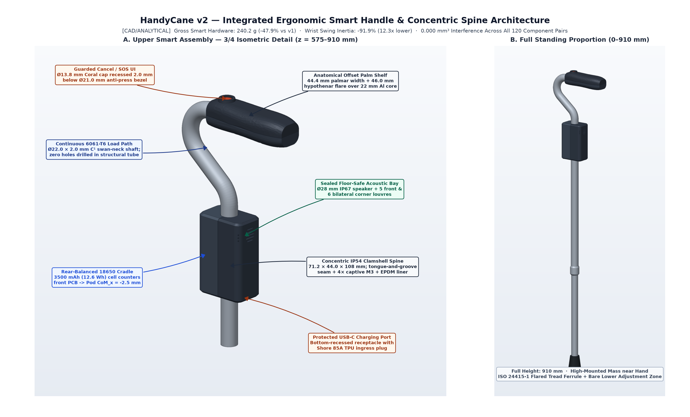
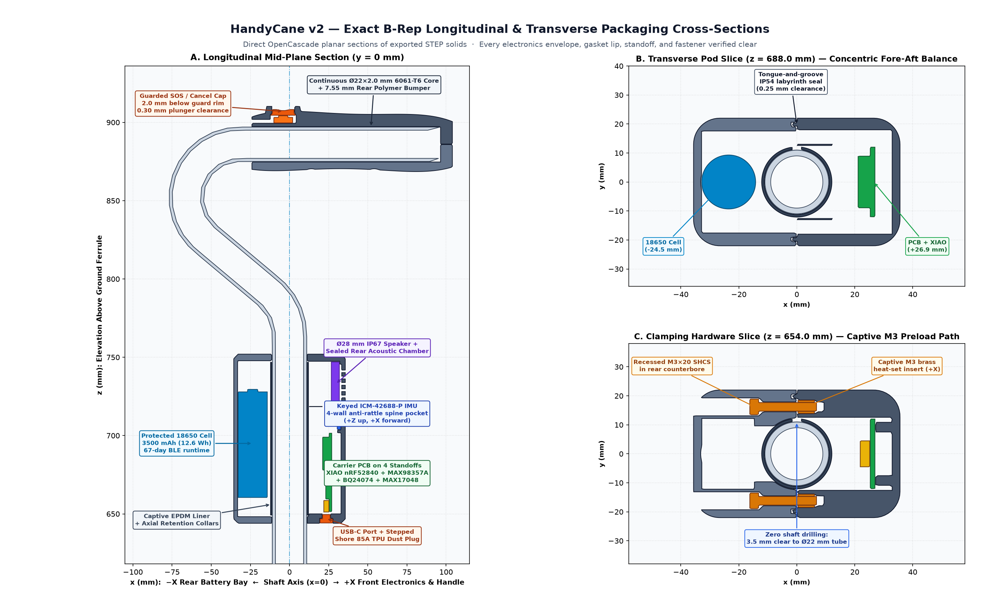

# Hardware

## v2 Engineered Biomedical Architecture (`hardware/cad_v2/`)

HandyCane v2 replaces the v1 zip-tied open trays with an anatomically contoured over-core smart handle and a concentrically balanced, gasketed under-handle electronics spine mounted on a continuous unbroken `Ø22.0 × 2.0 mm` 6061-T6 aluminum swan-neck shaft (`0` holes drilled in the structural tube).

- **Full Engineering Specification & Trade Study**: [`docs/PRODUCT_REDESIGN_V2.md`](../docs/PRODUCT_REDESIGN_V2.md)
- **Parametric B-Rep CAD Suite & Print-Ready STLs/3MFs**: [`hardware/cad_v2/`](cad_v2/) ([`README.md`](cad_v2/README.md))
- **Automated `0.000 mm³` Interference & Physics Verification**: [`hardware/cad_v2/verification_v2.json`](cad_v2/verification_v2.json)
- **Autodesk Fusion 360 Import Script (reference User Parameters)**: [`hardware/fusion360/HandyCaneV2_ImportAndParams/`](fusion360/HandyCaneV2_ImportAndParams/)
- **Native Parametric Fusion 360 `pod_front_shell` (parameter-driven features, 0.0 mm³ difference vs STEP)**: [`hardware/fusion360/HandyCaneV2_PodFrontShell/`](fusion360/HandyCaneV2_PodFrontShell/)

| Hero Isometric (`cad_v2`) | Longitudinal Cross-Section (`cad_v2`) |
|---|---|
|  |  |

---

## v1 Hackathon Baseline (`hardware/cad/` — Historical Reference)

Two open trays were printed and strapped to the cane's upper shaft with zip ties during the initial BioHacks prototype (`main` commit `bac9e09`). Retained here as the baseline reference measured by [`hardware/cad_v2/verify_cad_v2.py`](cad_v2/verify_cad_v2.py).

| File | What it is | Size (mm) |
|---|---|---|
| `cad/pi_cane_case.stl` | Open tray for the Raspberry Pi, cantilevered forward off the shaft | 222 x 69 x 45 |
| `cad/bank_holder.stl` | Open tray for the 10 Ah USB power bank | 138 x 70 x 34 |

| Assembled (v1) | Pulled apart (v1) |
|---|---|
|  |  |
